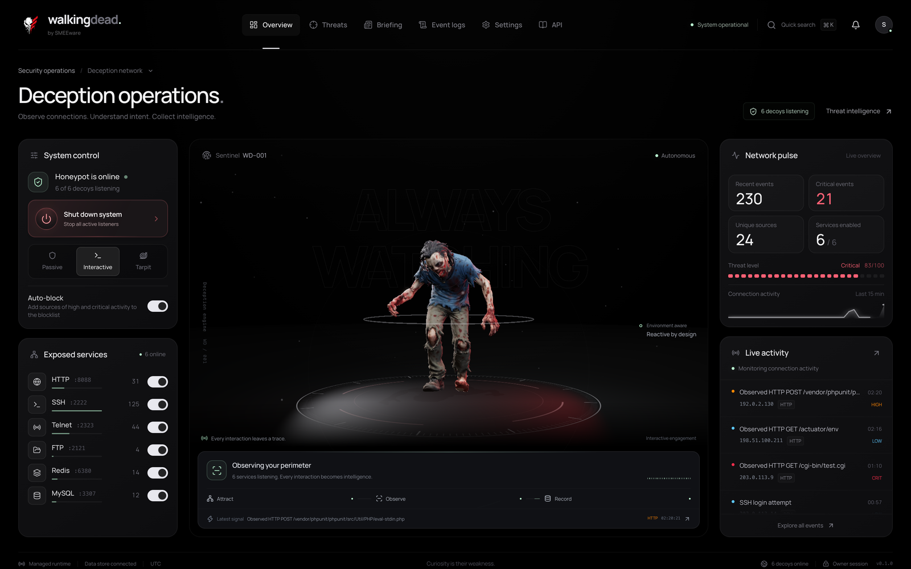

# Walking Dead Console

Static Next.js console for the honeypot, built with React, TypeScript, Three.js,
Tailwind CSS and Lucide icons. It is exported with `output: "export"` and
embedded into `wdd`; the Go backend owns authentication, listeners and data.

<p align="center">
  
</p>

## Pages

| Route | Contents |
| --- | --- |
| `/` | Overview: system control, decoy services, live activity, network pulse and the 3D sentinel |
| `/threats` | Attacker profiles, credentials, MITRE ATT&CK techniques, IOCs, heatmap and blocklist |
| `/briefing` | Daily briefings, local or AI-generated, with evidence links |
| `/logs` | Event explorer and connection sessions with search, filters and CSV/JSON export |
| `/settings` | Decoys, webhooks, access and API keys, appearance, stage, AI, alerts and data |
| `/docs` | Public API reference generated from `backend/api/openapi.json` |

Every route except `/docs` sits behind the authentication gate, which checks
`/bootstrap` and `/auth/session` before any data provider mounts. An expired
session removes the provider tree and its in-memory data.

## The sentinel

`lib/zombie-scene.ts` renders the Feral Walker model
(`public/assets/objects/feral-walker-web.glb`) with Three.js and bloom. While the
honeypot runs, the walker faces the viewer and walks in place; the ground discs
rotate instead (drag to spin them). Captured events trigger reactions: a shell
login or exploit plays the lunge-and-bite attack, hostile commands and failed
logins a roar, scans the grasping walk. Power-off plays the death animation, and
power-on plays it in reverse. Rendering pauses when hidden, offscreen or on other
routes, and reduced-motion preferences get still poses.

Regenerate the web model after changing the authoring model:

```sh
node scripts/optimize-model.mjs   # assets/models/feral-walker.glb → public/assets/objects/
```

## API docs

`scripts/sync-openapi.mjs` copies the backend contract to `lib/docs/openapi.json`
(rendered by `/docs`) and `public/openapi.json` (downloadable). It runs
automatically before `npm run dev` and `npm run build`; `tests/openapi-sync.test.mjs`
fails when the copies are stale.

## Data flow

The console reads `/system`, recent events and threat data over HTTP with cookie
credentials and no browser caching. `/stream` server-sent events trigger
coalesced refetches, with a 15-second polling fallback. Times and day partitions
use UTC. CSV exports prefix formula-like cells so spreadsheets do not execute them.
Passwords, API keys and session tokens are never written to browser storage.

## Development

```sh
npm ci --cache ../.cache/npm
cp .env.example .env.local        # NEXT_PUBLIC_API_URL for hot reload
npm run dev -- --hostname 127.0.0.1
npm test && npm run lint
```

Start the backend with `--allowed-origin http://127.0.0.1:3000` for hot reload and
use the same hostname for console and API so session cookies stay same-site.
Release builds (`./build.sh`) use `NEXT_PUBLIC_API_URL=/api/v1` and embed `out/`.
